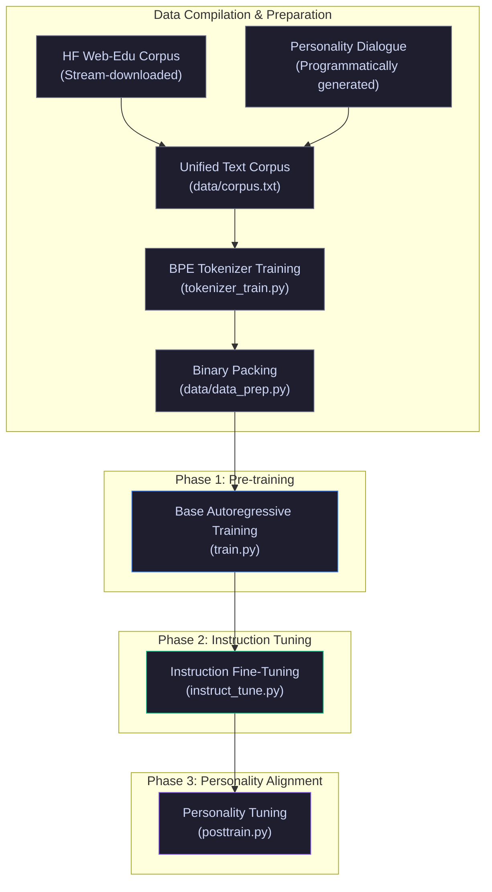

# 🐦‍⬛ RAVEN-2: An Experimental 100M Parameter Transformer

RAVEN-2 is a simple, educational 100M parameter language model codebase written in PyTorch. It implements standard modern transformer components (RMSNorm, RoPE, SwiGLU, Grouped Query Attention, and a basic KV cache) to provide a clear, hands-on environment for training and experimenting on a single GPU or Google Colab.

---

## 🎛️ Architecture Specifications

The model architecture is configured with standard parameters common to modern open-weight architectures, scaled down for fast training and testing.

### Hyperparameters

| Spec / Parameter | Value | Description / Formula |
| :--- | :--- | :--- |
| **Vocabulary Size ($V$)** | `16,384` | Tokens trained via a basic Byte-Level BPE tokenizer |
| **Context Length (Block Size)** | `1,024` tokens | Maximum sequence length supported by the attention layers |
| **Embedding Dimension ($d$)** | `768` | Hidden size of the transformer layers |
| **Query Heads ($N_{\text{head}}$)** | `12` | Number of attention heads for Query projections |
| **Key/Value Heads ($N_{\text{kv}}$)** | `4` | Key/Value heads shared across Query heads (Group size = 3) |
| **Decoder Layers ($N_{\text{layer}}$)** | `12` | Total number of transformer decoder blocks |
| **Activation Function** | SwiGLU | Swish-Gated Linear Units with `ffn_mult = 4.5` |
| **Feed-Forward Hidden Dim** | `2,304` | Computed as: $\text{round}(n_{\text{embd}} \times f_{\text{mult}} \times \frac{2}{3 \times 256}) \times 256$ |
| **Total Parameter Count** | `~100M` | Unique parameters (excluding tied embedding weights) |

---

### Component Implementations

#### 1. Root Mean Square Normalization (RMSNorm)
RMSNorm is used instead of standard LayerNorm to reduce computational overhead by normalizing inputs by their root mean square:
$$\text{RMSNorm}(x) = \frac{x}{\sqrt{\frac{1}{d} \sum_{i=1}^d x_i^2 + \epsilon}} \odot \gamma$$
Where $\gamma$ is a learnable scaling parameter. No bias weights are configured in the normalization layers.

#### 2. Rotary Position Embeddings (RoPE)
Positional information is applied by rotating query and key components:
$$\begin{pmatrix} rx_{2i-1} \\ rx_{2i} \end{pmatrix} = \begin{pmatrix} \cos \theta_i & -\sin \theta_i \\ \sin \theta_i & \cos \theta_i \end{pmatrix} \begin{pmatrix} x_{2i-1} \\ x_{2i} \end{pmatrix}$$
Where $\theta_i = \text{base}^{-2(i-1)/d} \cdot t$ represents the frequency scaling for position index $t$.

#### 3. SwiGLU Activation Function
The feed-forward network uses SwiGLU projections:
$$\text{SwiGLU}(x) = \text{Swish}(x W_{\text{gate}}) \cdot (x W_{\text{up}})$$
With our hyperparameter selections, the feed-forward layer maps to a hidden dimension of **2,304**.

#### 4. Grouped Query Attention (GQA)
Key and Value heads are shared across Query heads to reduce memory bandwidth usage during sequence generation. The code uses PyTorch's native scaled dot-product attention (`F.scaled_dot_product_attention`).

---

## 🛠️ Data & Training Workflow

The training pipeline is structured in three consecutive phases, moving from raw text datasets to custom fine-tuning.



---

## 📁 Repository Structure

```
Raven-2/
├── config.py                     # Hyperparameters and model configuration parameters
├── model.py                      # Core model definitions (RMSNorm, RoPE, SwiGLU, GQA, KV Cache)
├── requirements.txt              # Project third-party dependencies
├── tokenizer_train.py            # Simple BPE tokenizer training script
├── train.py                      # Standard pre-training loop with cosine decay
├── instruct_tune.py              # Basic instruction fine-tuning loop
├── posttrain.py                  # Fine-tuning script for personality alignment
├── inference.py                  # Command-line chat client with conversation history
├── app.py                        # Simple Gradio Web UI for model interaction
├── .gitignore                    # Git ignore configurations
├── README.md                     # Project documentation (this file)
├── data/
│   ├── build_dataset.py          # Script to stream and download open datasets
│   ├── build_personality_corpus.py # Script to programmatically generate personality dialogues
│   ├── build_instruct_data.py    # Script to programmatically generate instruction pairs
│   ├── download_data.py          # Data downloader helper
│   ├── combine_to_1gb.py         # Helper script to shuffle and chunk raw text
│   └── data_prep.py              # Script to pack text files into binary memory-mapped files
├── eval/
│   ├── knowledge_bench.py        # Small set of Wikipedia factual checks
│   ├── reasoning_bench.py        # Basic mathematical and logical checks
│   └── run_full_eval.py          # Evaluation runner script
└── notebooks/
    ├── colab_pretrain.ipynb      # Basic pre-training Jupyter notebook
    ├── colab_instruct.ipynb      # Basic instruction fine-tuning Jupyter notebook
    └── colab_posttrain.ipynb     # Basic post-training Jupyter notebook
```

---

## 🚀 Step-by-Step Run Guide

### 1. Environment Setup
Install the necessary requirements (Python 3.10+ recommended):
```bash
pip3 install -r requirements.txt
```

### 2. Download and Compile Raw Text Corpus
Download raw training text streamingly from open sources (such as FineWeb-Edu):
```bash
python3 data/build_dataset.py --target_gb 2     # Build a small 2GB subset for testing
python3 data/build_dataset.py --target_gb 40    # Build a larger 40GB corpus
```

### 3. Train the Tokenizer
Train a custom Byte-Level BPE tokenizer on the downloaded corpus:
```bash
python3 tokenizer_train.py
```
*This output writes `checkpoints/raven2_tokenizer.json` and assigns special tokens: `<|pad|>` (0), `<|user|>` (1), `<|raven|>` (2), `<|eos|>` (3), and `<|system|>` (4).*

### 4. Build the Instruction Dataset
Generate a synthetic dataset of instruction-response pairs:
```bash
python3 data/build_instruct_data.py --dry-run
python3 data/build_instruct_data.py
```

### 5. Pack Text into Binary Format
Convert text corpora into standard uint16 binary files for memory-mapped training:
```bash
python3 data/data_prep.py --mode pretrain      # Prepares checkpoints/train.bin and val.bin
python3 data/data_prep.py --mode instruct      # Prepares checkpoints/instruct.bin and instruct_val.bin
```

### 6. Phase 1: Pre-training
Start base autoregressive pre-training:
```bash
python3 train.py --dry-run                # Runs a short 20-step test
python3 train.py                          # Starts full pre-training
```
*The script saves checkpoint states to `checkpoints/raven2_pretrain_best.pt` during training.*

### 7. Phase 2: Instruction Fine-Tuning
Fine-tune the model using target loss masking:
```bash
python3 instruct_tune.py
```
*In this step, loss is calculated only on the assistant's output tokens, ignoring prompt inputs.*

### 8. Phase 3: Personality Alignment
Fine-tune the model on the generated personality dataset:
```bash
python3 posttrain.py
```

### 9. Validation & Evaluation
Run standard validation checks to inspect model output:
```bash
python3 eval/run_full_eval.py
```
*Prints a summary score across factual questions, simple reasoning checks, and basic text generation.*

### 10. Start the Chat Interfaces
Interact with a trained model checkpoint:
```bash
# Terminal Interface
python3 inference.py

# Basic Web UI
python3 app.py
```

---

## 🎨 Interactive CLI Client Commands

In `inference.py`, the chat interface supports basic back-slash controls during dialogue:

| Command | Action | Explanation |
| :--- | :--- | :--- |
| `/mode [name]` | Switch sampling parameters | Switches active presets (`precise`, `sharp`, `default`, `chaos`, `cold`). |
| `/modes` | View sampling parameters | Lists active temperature, top-k, top-p, and penalty configurations. |
| `/system [text]` | Modify system prompt | Overrides the current system message context on the fly. |
| `/stats` | View performance data | Shows generation speeds (tokens per second) and basic parameters. |
| `/reset` | Reset context | Clears active conversational history (maintains a short rolling context). |
| `/save` | Save dialogue | Exports conversation history to a local text file. |
| `/clear` | Clear screen | Clears the active terminal window screen. |
| `/exit` | Exit client | Closes the command-line interface. |

---

## ☁️ Google Colab Setup

Jupyter notebooks are available in `/notebooks/` to set up and run training or fine-tuning workflows in Google Colab. The codebase includes checks to mount `/content/drive` to save intermediate model states during training.

---

## ⚙️ Implementation Notes

* **Parameter Checks**: During initialization, `model.py` checks that unique parameter counts fall within reasonable bounds (`90M <= parameter count <= 115M`) to prevent configuration errors.
* **Refusal Pairs**: The programmatic instruction builder includes basic refusal templates where the model declines to speculate on real-time facts outside its configuration.
* **Loss Masking**: Prompt token labels are set to `-100` during fine-tuning so that cross-entropy loss gradients are only calculated for target responses.
* **Signal Handling**: The training loops catch SIGINT (`Ctrl+C`) to save the current model state and configurations before shutting down.
